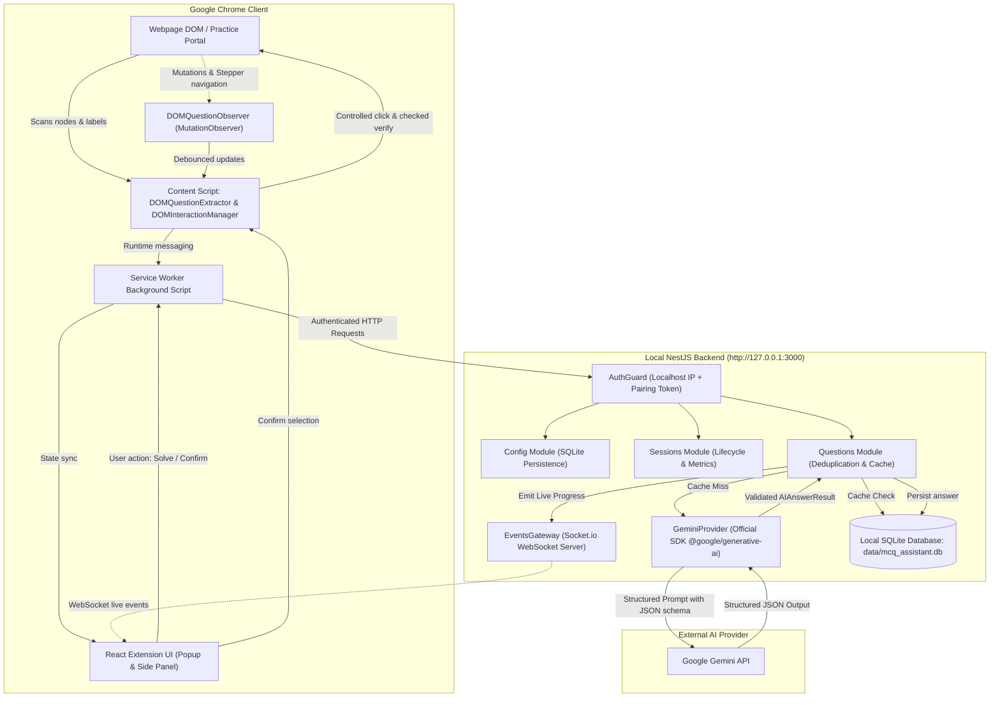
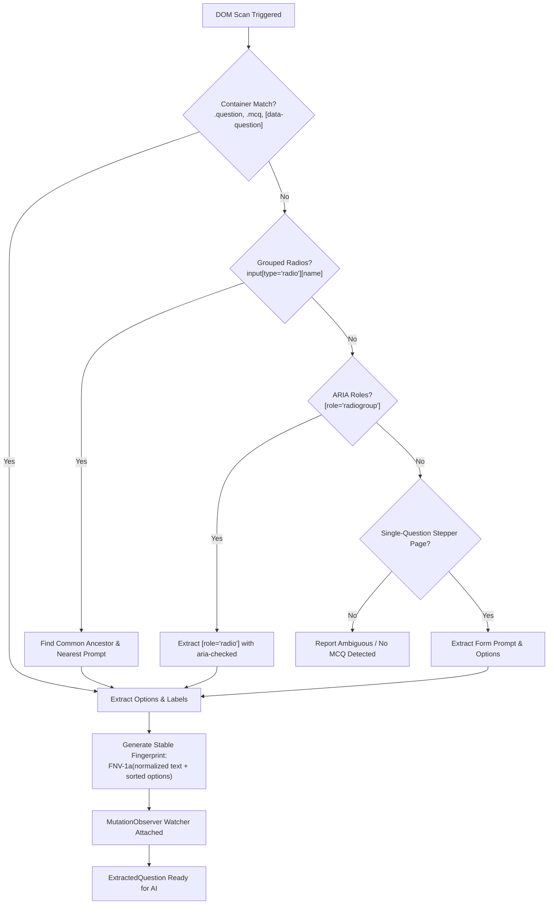
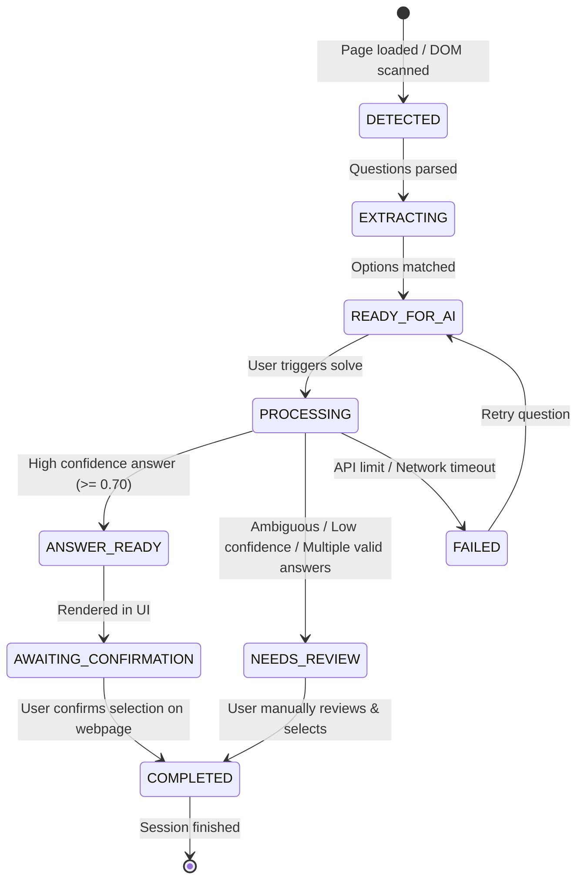

# AI MCQ Assistant Architecture Document

## 1. System Overview

AI MCQ Assistant is a local-first system designed for learners solving practice multiple-choice questions. It provides real-time DOM extraction, intelligent AI reasoning through Google Gemini, and interactive selection confirmation without sending sensitive data to third-party cloud servers.

---

## 2. Extraction Pipeline

---

## 3. Session State Machine

---

## 4. Security Principles

1. **Strict Localhost Binding**: The backend listens solely on loopback `127.0.0.1`.
2. **Credential Privacy**: The Gemini API key never passes to the Chrome Extension content script or web pages.
3. **Controlled Browser Interaction**: Elements are checked using standard dispatch events, verifying the element state without arbitrary eval execution.

